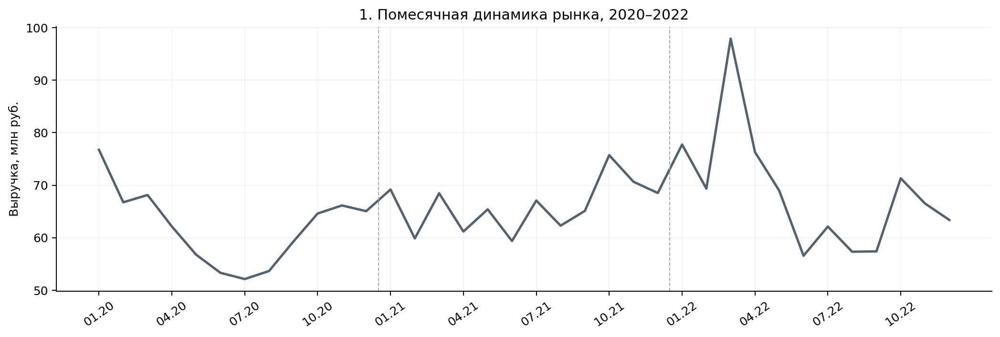
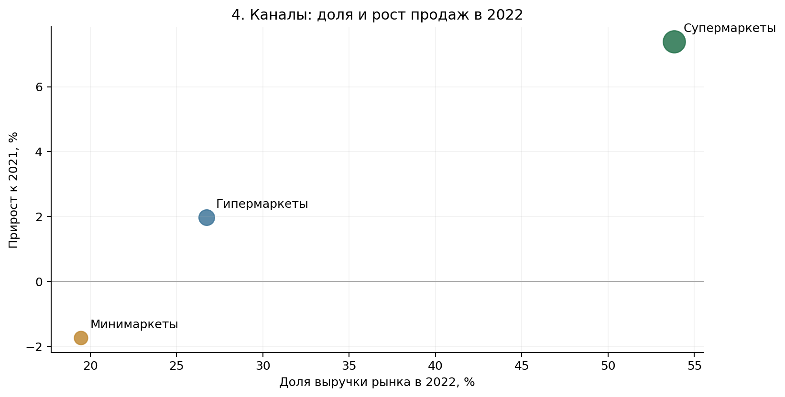

# Анализ снижения продаж и доли рынка консервированной продукции

**Предмет исследования:** продажи бренда Green и его конкурентов за 2020-2022 годы в гипермаркетах, супермаркетах и минимаркетах. В выборке представлены бренды и весовые категории консервированной продукции.

**Цель исследования –** определить, в каких каналах и товарных сегментах бренд Green отстаёт от рынка, оценить изменение конкурентных позиций и выделить направления для дальнейшего анализа продаж.

## Результаты

| Показатель | 2021 | 2022 | Изменение |
|---|---:|---:|---:|
| Продажи категории, млн руб. | 793,0 | 825,0 | **+4,0%** |
| Продажи Green, млн руб. | 522,7 | 500,7 | **−4,2%** |
| Продажи Blue, млн руб. | 163,4 | 221,4 | **+35,4%** |
| Доля Green в продажах категории | 65,9% | 60,7% | **−5,2 п. п.** |

Green остаётся лидером по денежным продажам, но теряет долю на растущем рынке. Падение особенно заметно в конце 2022 года: за октябрь–декабрь продажи бренда снизились на **15,5%** к тому же периоду 2021 года, а в декабре – на **19,6%**. Для всей категории снижение за эти периоды составило **6,4%** и **7,5%** соответственно.

### Различия между каналами

В 2022 году денежные продажи Green изменились неодинаково:

| Канал | Динамика Green к 2021 году | Динамика всей категории |
|---|---:|---:|
| Гипермаркеты | **−13,9%** | +2,0% |
| Супермаркеты | +2,0% | +7,4% |
| Минимаркеты | −6,8% | −1,7% |

Самое сильное снижение у Green – в **гипермаркетах**. В супермаркетах бренд вырос, но уступил темпам категории. На этот канал приходится **53,8%** денежных продаж рынка за 2022 год, поэтому динамика внутри него существенно влияет на общую конкурентную позицию.

### Конкуренция и ассортимент

Blue вырос на **35,4%** за год, тогда как продажи Green снизились. Помесячное сравнение долей брендов в супермаркетах и весовых группах 350–599 г позволяет проследить, когда усилились изменения в структуре категории. Эти данные не доказывают прямой переход покупателей от Green к Blue: для такого вывода потребуются данные о покупательских корзинах, промо и наличии товаров.

[График изменения долей брендов](brand_share_dynamics.png)

Проверка цен и продаж на торговую точку показала различия между каналами и весовыми группами. Гипотеза о неизменно меньшей цене за грамм у крупной упаковки **не подтвердилась** в исследованных срезах. Сравнивать такие цены необходимо внутри сопоставимых категорий, учитывая состав ассортимента.

## Проверка качества данных

Исследование выполнено на **2 008 строках** продаж за три года. При подготовке общей таблицы исправлены **169 искажённых названий Green** и **120 некорректно записанных числовых значений**. После очистки пересчитаны ключевые показатели и проверены исходные предположения.

Отдельно выявлены **246 строк с положительными продажами при нулевом количестве торговых точек**. До уточнения значения показателя `Number of stores` офтейк (продажи на точку) нельзя использовать как окончательный критерий эффективности.

## Выводы и дальнейшие действия

1. **Проверить гипермаркеты в первую очередь.** Разложить падение выручки Green на изменения продаж в штуках, средней цены, ассортимента и представленности товаров.
2. **Сравнить Green и Blue внутри одинаковых весовых сегментов и каналов.** Проверить динамику цен, долей и объёмов по месяцам.
3. **Дополнить исследование данными о промо, остатках и наличии SKU.** Текущие данные показывают, где возникло отставание, но не позволяют достоверно назвать его причину.
4. **Уточнить число торговых точек** перед использованием показателя офтейка в отчётности.

## Файлы

**[Green_sales_analysis.xlsx](Green_sales_analysis.xlsx)** – единая Excel-книга с очищенными данными, месячными и годовыми метриками, анализом каналов, долями брендов, проверкой гипотез и сводкой результатов.

Графики: [динамика категории](market_sales_trend.png) · [структура каналов](channel_structure.png) · [доли брендов](brand_share_dynamics.png).

Расчёты относятся к представленному набору данных.
